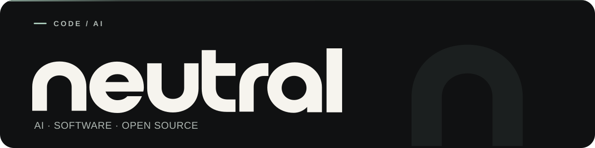
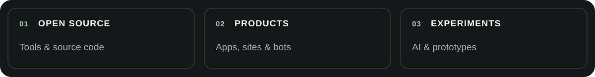

  <picture>
    <source media="(prefers-color-scheme: dark)" srcset="./assets/neutral-hero-dark.svg">
    <source media="(prefers-color-scheme: light)" srcset="./assets/neutral-hero-light.svg">
    
  </picture>

  

    <a href="https://t.me/neutral_io">Telegram</a> · <a href="https://github.com/orgs/neutralio/repositories">Repositories</a>
  

### About

AI, vibe coding, and the things I build. I share open-source tools and experiments here.

<picture>
  <source media="(prefers-color-scheme: dark)" srcset="./assets/neutral-areas-dark.svg">
  <source media="(prefers-color-scheme: light)" srcset="./assets/neutral-areas-light.svg">
  
</picture>
